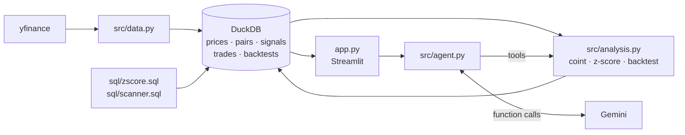

# Pairs-Trading Research Agent

**Live demo:** https://fintech-pairtrading-gsldaouwcbewbwokz9mztj.streamlit.app/

> **Not investment advice.** This is a research and learning project. Backtests are historical and do not predict future results.

## Problem
Some stock pairs (KO/PEP, V/MA, ...) tend to move together. If the spread between them is *mean-reverting*,
then unusually wide spreads should narrow again. This project tests that idea honestly: it fits on one
period, tests on a later one it has never seen, includes trading costs, and reports when a relationship breaks down.

## Method
1. **Data:** daily adjusted closes since 2015 (yfinance), stored in DuckDB.
2. **Fit (2015-2020 only):** Engle-Granger cointegration test, plus an OLS hedge ratio `beta` on log prices.
   Spread = `log(A) - beta*log(B)`. Beta is **never refit**.
3. **Signal:** rolling 60-day z-score of the spread, computed in pandas *and* in SQL window functions (`sql/zscore.sql`). A test checks that the two match.
4. **Backtest (2021-today, out of sample):** enter at |z| >= 2 (short the spread if z > 0, long if z < 0),
   exit at z = 0, stop out at |z| >= 3 with no re-entry until |z| < 2 again. A position decided at today's close earns
   from tomorrow onward (no look-ahead). Costs are 5 bps per leg. P&L is in log-spread units.
5. **Still cointegrated?** ADF test on the *fixed-beta* spread over the test period.
6. **Agent:** Gemini with function calling and a manual tool loop (max 8 tool calls, token cap, one retry on 429).
   It has 4 tools: `get_prices`, `test_cointegration`, `run_backtest`, and a read-only `query_results(sql)`.



## Results (fit 2015-2020, test 2021-01-04 to 2026-10-14)
| Pair | Fit EG p-value | Hedge ratio | Test ADF p-value | Still coint.? | OOS Sharpe | Max DD | Trades |
|---|---|---|---|---|---|---|---|
| V-MA    | 0.034 | 0.81 | 0.491 | No  |  0.24 | -0.132 | 30 |
| KO-PEP  | 0.080 | 0.76 | 0.998 | No  | -0.34 | -0.290 | 28 |
| HD-LOW  | 0.198 | 1.10 | 0.014 | Yes |  0.13 | -0.135 | 24 |
| GLD-GDX | 0.612 | 0.50 | 0.765 | No  | -0.40 | -0.330 | 27 |
| XOM-CVX | 0.971 | 0.51 | 0.298 | No  | -0.09 | -0.272 | 23 |

**Takeaways**
- Only V-MA was cointegrated at 5% in the fit period, and with the fixed beta its spread was **not** stationary out of sample.
  Refitting on 2021+ gives beta ≈ 1.02 and p ≈ 0.027, so the relationship persisted but the hedge ratio drifted.
- KO-PEP broke down completely out of sample (ADF p ≈ 1.0).
- HD-LOW was not significant in-sample but did look stationary out of sample. A good in-sample p-value is a weak predictor.
- No pair produced a convincing Sharpe after costs. That is a normal, honest outcome for textbook pairs.

## Limitations
- Only 5 hand-picked pairs, so there's selection bias and no multiple-testing correction.
- P&L is in log-spread units, with no capital or leverage model and no borrow costs or slippage beyond 5 bps per leg.
- A static hedge ratio. A rolling or Kalman beta would adapt, at the cost of more parameters.
- Daily closes only: fills are assumed at the close.
- The LLM can still misread tool output. Every number in its answer is shown next to the tool call it came from.

## How to run
```bash
python3.11 -m venv venv && venv/bin/pip install -r requirements.txt
cp .env.example .env            # add your GEMINI_API_KEY (free tier works)
venv/bin/python -m src.data     # download prices, fit, backtest (also runs on first app start)
venv/bin/pytest -q
venv/bin/streamlit run app.py
```
CLI agent: `venv/bin/python -m src.agent "Did KO-PEP break down after 2020?"`. Stop the app first:
DuckDB allows only one writing process per file.

Default model is `gemini-3.5-flash-lite`. Each question costs one request per tool round (usually 2-7),
and free-tier quotas are per model per day, so `gemini-3.8-flash` (about 20 requests/day free) runs out fast.
To deploy on Streamlit Cloud, put `GEMINI_API_KEY` in the app's secrets.
